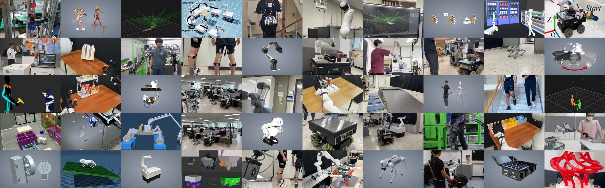

<!-- section full -->

  <!-- Photo mosaic: regenerate with scripts/build_hero_mosaic.py -->
  
  

    
    <h1 class="home_hero_title"><b>H</b>um<b>A</b>n-<b>R</b>obot <b>CO</b>llaboration Research Lab</h1>
    
Department of Robot Engineering · Hanyang University

  



  

  We study how humans and robots can work together safely and reliably, in both physical and cognitive tasks. 
  Our research spans physical human-robot interaction (pHRI), shared and whole-body control, ergonomics and human factors, haptic and tactile sensing, powered exoskeletons, and robot learning.
  

  
Interested in joining HARCO Lab? Email your CV to <a href="mailto:wansookim+app@hanyang.ac.kr">wansookim+app@hanyang.ac.kr</a>.






